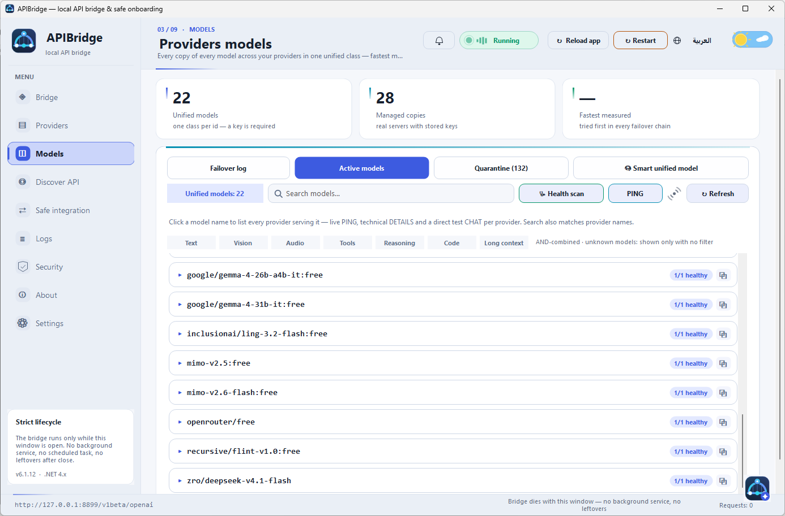
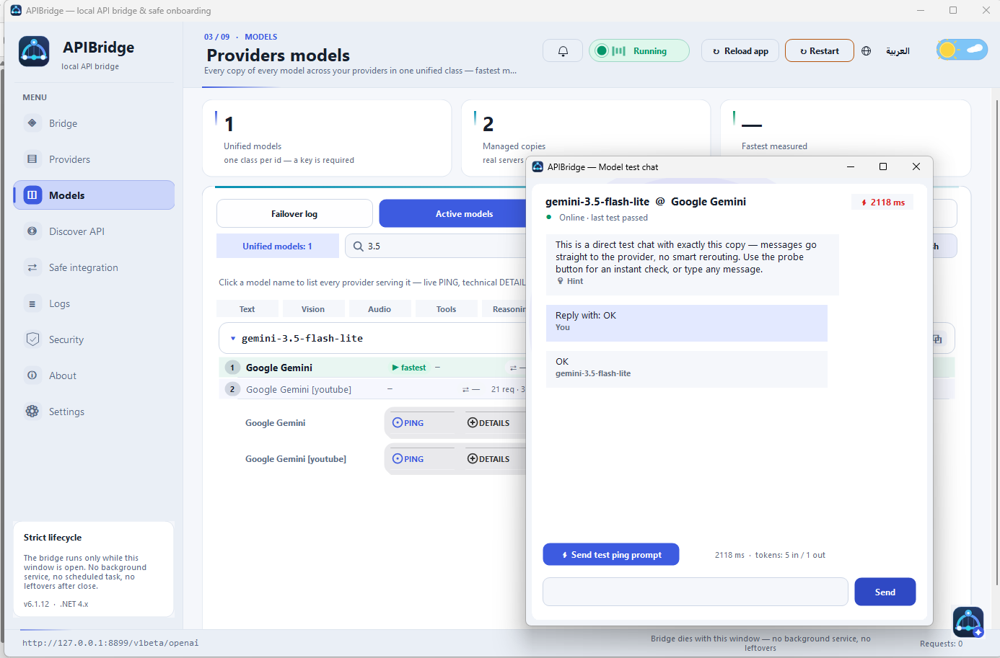
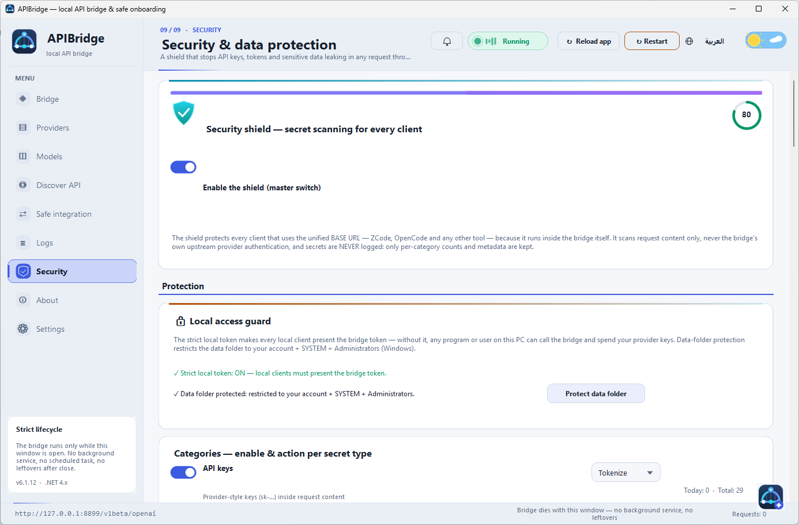
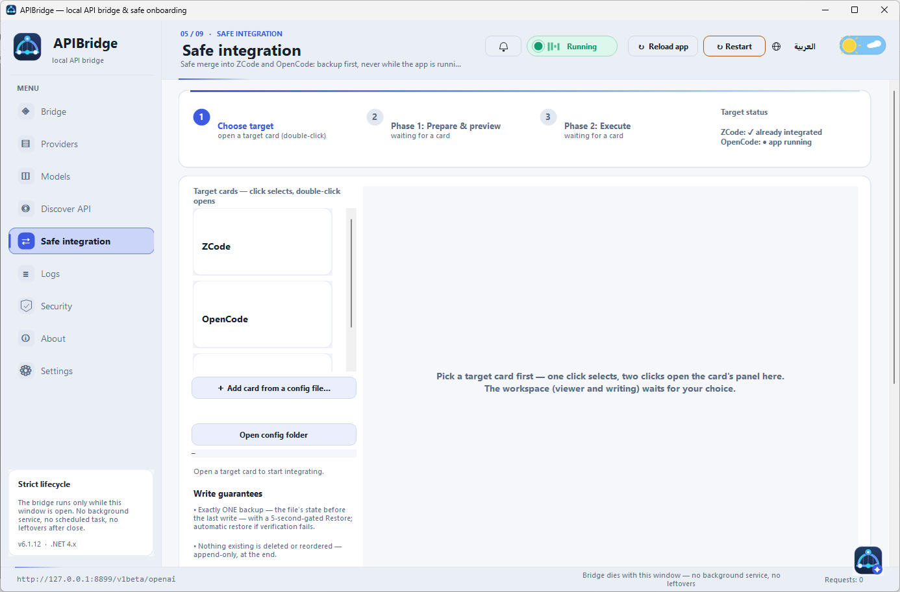
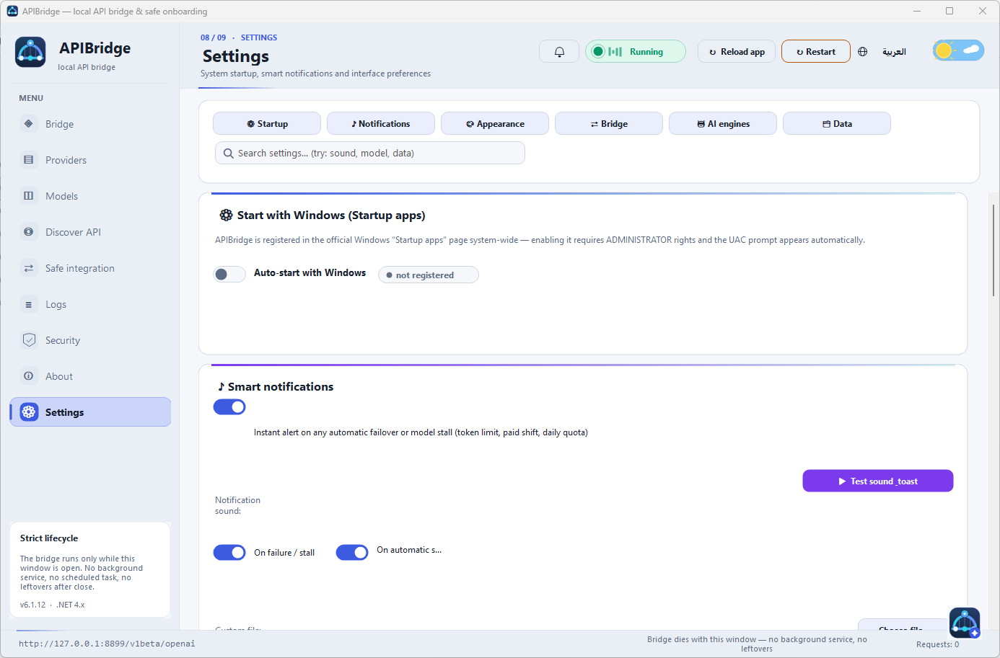
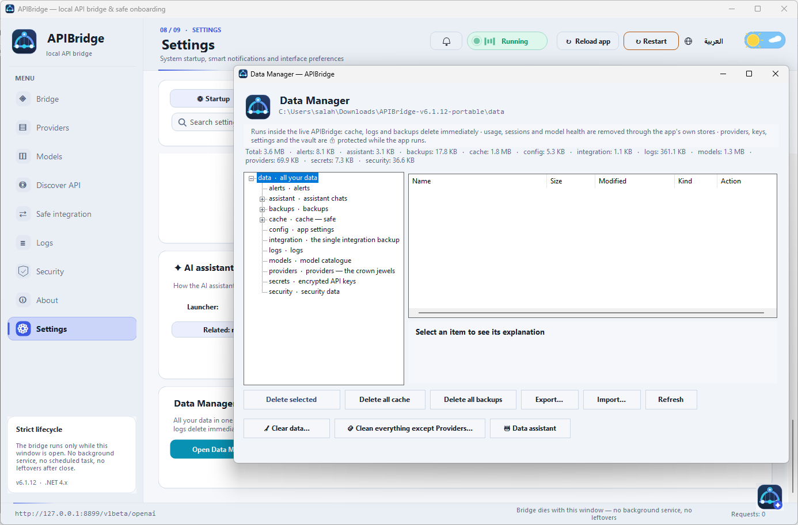

# APIBridge

[](https://github.com/salahamrabdelraouf/APIBridge/releases/latest)
[](LICENSE)
[](https://github.com/salahamrabdelraouf/APIBridge/stargazers)
[](https://github.com/salahamrabdelraouf/APIBridge/releases/latest)
[](PRIVACY.md)

🌐 **اللغة:** [English](README.md) | العربية

**عنوان محلي واحد لكل مزوّدي الذكاء الاصطناعي عندك — ظبّط أدوات الكودينج مرة واحدة، وبدّل النماذج والمزوّدين من غير ما تلمس إعداداتها تاني أبداً.**

APIBridge جسر API محلي لويندوز. يقف بين أدوات الكودينج عندك (ZCode أو OpenCode أو أي عميل متوافق مع OpenAI) وبين مزوّدي الذكاء الاصطناعي، ويعرض عنواناً محلياً ثابتاً واحداً، ويوجّه كل طلب للمزوّد والنموذج الصح — مع تبديل تلقائي عند فشل أي نموذج أو مزوّد.

> **محلي أولاً، بالتصميم.** APIBridge بلا سحابة، وبلا حساب، وبلا أي تتبّع. مفاتيحك محفوظة على جهازك أنت فقط. راجع [PRIVACY.md](PRIVACY.md) لتعرف بدقة ما يفعله APIBridge وما لا يفعله — مكتوب بدقة، لأن الدقة هي الثقة.

---

## لماذا APIBridge؟

- **عنوان واحد، للأبد** — أدواتك تشير لعنوان محلي واحد، مرة واحدة. أضف أو احذف أو أعد ترتيب المزوّدين داخل APIBridge؛ أدواتك لن تلاحظ شيئاً.
- **تبديل لنفس النموذج** — إذا فشل نموذج عند مزوّد، يُجرَّب النموذج نفسه تلقائياً عند المزوّد التالي الذي يقدّمه.
- **🧠 نموذج ذكي موحّد** — نموذجان يعملان كفريق ويعيدان إجابة **واحدة** موحّدة، بمنسّق تختاره أنت وسلسلة بدائل عند نفاد رصيد نموذج أو فشله — بما في ذلك الاستكمال من نقطة التوقف نفسها أثناء البث.
- **عزل تلقائي** — النماذج التي تصطدم بحدود الحصة أو أعطال اتصال متكررة تُعزل تلقائياً وتُعاد جدولتها للاختبار بتصاعد (ساعتان، ثم ٥ ساعات، ثم يومياً حتى ٧ أيام)، ثم تعود من تلقاء نفسها عند تعافيها.
- **مدير بيانات داخل الإعدادات** — اعرف ما يخزّنه كل ملف في مجلد البيانات، واحذف الكاش والنسخ الاحتياطية بأمان، وامسح كل شيء عدا مزوّديك، وصدّر/استورد — مع شرح ووسم أمان لكل عنصر.
- **أمان مبني من الأساس** — مستمع على العنوان المحلي فقط، وحارس Host/Origin، ووضع توكن محلي صارم اختياري، ودرع يمنع تسريب الأسرار من حركة المساعد، وفاحص مهارات، واستثناءات لمزوّدين موثوقين تعتمدها بنفسك.
- **مساعد ذكاء عائم** — تحدّث مع نماذجك من نافذة زجاجية منبثقة، بـMarkdown كامل، وتعديل/إعادة للمحاولات، ودردشة اختبار لكل نموذج (نبض، تفاصيل، محادثة حية) من صفحة النماذج مباشرة.
- **تكامل آمن** — يكتب APIBridge سجلّه في ملفات إعداد أدواتك بصيغتها الأصلية تماماً، مع نسخة احتياطية وتحقق JSON، واستعادة لا تُؤكَّد إلا بعد انتظار مقصود ٥ ثوانٍ.

## لقطات الشاشة

**النماذج** — نماذج كل المزوّدين في مكان واحد، ودردشة اختبار لكل نموذج على بُعد نقرة:



**دردشة اختبار النموذج** — جرّب أي نموذج عند أي مزوّد قبل أن تعتمد عليه:



**الأمان** — الدرع، ودرجات الثقة، وأدوات الاستثناءات:



**التكامل الآمن** — كتابة سجل الجسر في إعداد أداتك، مع نسخة احتياطية وتحقق:



**مدير البيانات، داخل الإعدادات** — كل ملف مشروح وموسوم قبل أن تلمسه:





## ما يفعله / ما لا يفعله

| ✅ APIBridge يفعل | ❌ APIBridge لا يفعل |
| --- | --- |
| يخزّن مفاتيحك **محلياً على جهازك**، مشفرة أثناء السكون (Windows DPAPI) | إرسال مفاتيحك لخوادم APIBridge — **لا توجد خوادم أصلاً** |
| يعطي الأدوات المتصلة **توكناً محلياً** (في الوضع الصارم)، وليس مفاتيحك الحقيقية أبداً | جمع تحليلات أو بيانات تتبّع أو استخدام من أي نوع |
| يرسل لكل مزوّد **مفتاحه هو فقط**، كتسجيل الدخول الطبيعي لطلبك | العمل في الخلفية بعد إغلاقك له — الجسر يحيا ويموت مع نافذة التطبيق |
| يحتفظ بالسجلات وإحصاءات الاستخدام والتاريخ **على جهازك** | تعديل مزوّدي أدواتك أو مفاتيحها أو إعداداتها الأخرى أثناء التكامل |
| يبدّل ويعزل ويعيد اختبار النماذج **تلقائياً** | أن يعدك بأن المزوّد نفسه لا يسجّل طلباتك — تلك سياسة المزوّد الخاصة |

البيان الكامل والدقيق في [PRIVACY.md](PRIVACY.md) و[SECURITY.md](SECURITY.md).

## التحميل والتحقق

الإصدارات **حزم ZIP محمولة** — بلا مثبّت، وبلا سجل نظام، وبلا AppData. فك الضغط، وشغّل `APIBridge.exe`، وانتهى. بياناتك تعيش في مجلد `data` بجانب الملف التنفيذي، فالتثبيت كله مجلد واحد يمكنك نقله أو نسخه احتياطياً.

كل إصدار ينشر `SHA256SUMS.txt` بجانب الحزمة المحمولة. تحقق من تحميلك قبل التشغيل:

```
certutil -hashfile APIBridge-vX.Y.Z-portable.zip SHA256
```

## بداية سريعة

1. فك ضغط حزمة الـZIP المحمولة في أي مكان.
2. شغّل `APIBridge.exe` وأضف مزوّداً (الصق رابط موقع + مفتاح API — وAPIBridge يكتشف نقطة الاتصال وكتالوج النماذج بنفسه).
3. افتح **التكامل الآمن**، واختر أداتك (ZCode / OpenCode)، واكتب سجل الجسر — مرة واحدة فقط.
4. استخدم أداتك كالمعتاد. معرّف النموذج في كل طلب يختار المزوّد؛ والتبديل التلقائي يتكفل بالباقي.

## حالة المشروع

APIBridge قيد التطوير النشط. خارطة الطريق العلنية وسجل التغييرات في [ROADMAP.md](ROADMAP.md) و[CHANGELOG.md](CHANGELOG.md)، والنصان نفسيهما قابلان للقراءة داخل التطبيق في صفحة «حول».

## ادعم المشروع

- ⭐ ضع نجمة لهذا المستودع
- 🐛 بلّغ عن خطأ عبر [Issues](https://github.com/salahamrabdelraouf/APIBridge/issues) (فضلاً استخدم القوالب)
- 💬 المجتمع: [Telegram](https://t.me/PromptixOfficial) · [Facebook](https://facebook.com/Promptix)
- ❤️ الرعاية مرحّب بها عبر GitHub Sponsors (زر Sponsor بالأعلى)

## المساهمة

راجع [CONTRIBUTING.md](CONTRIBUTING.md) و[مدونة السلوك](CODE_OF_CONDUCT.md).

## الرخصة

[MIT](LICENSE) — راجع ملف الرخصة للتفاصيل.

---

*APIBridge أداة محلية. ليست تابعة لـZCode أو OpenCode أو أي مزوّد ذكاء اصطناعي.*
