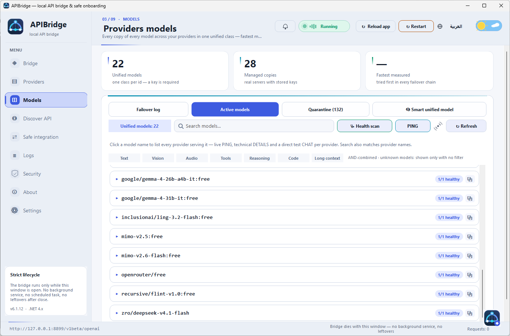
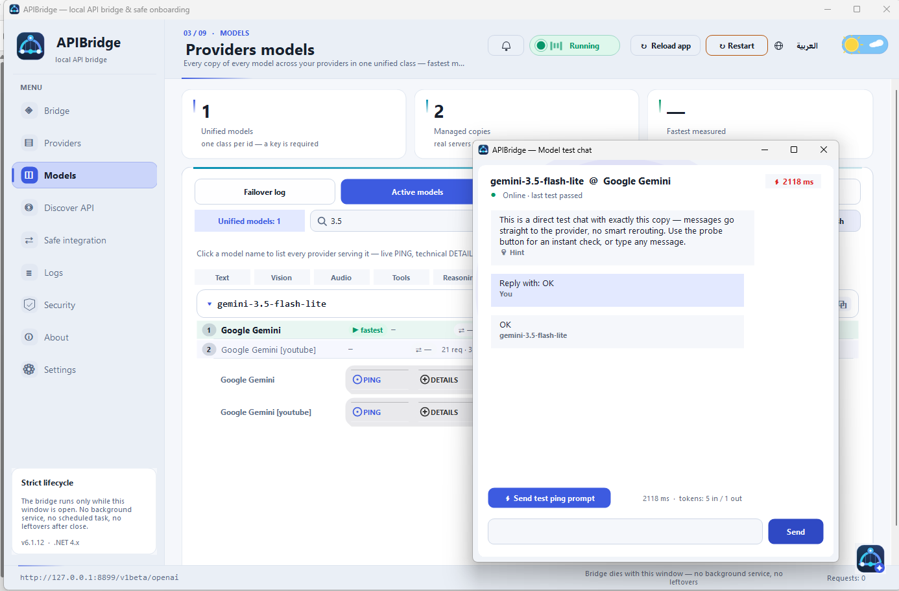
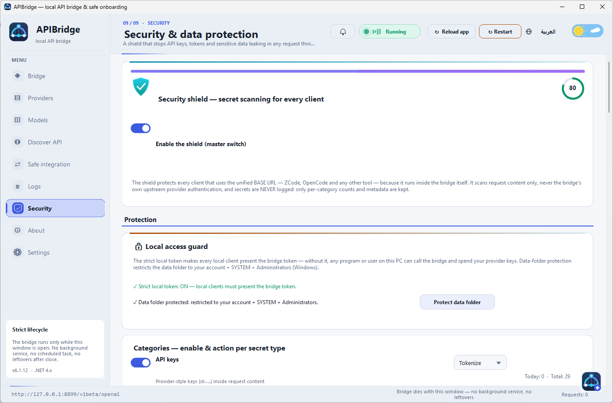
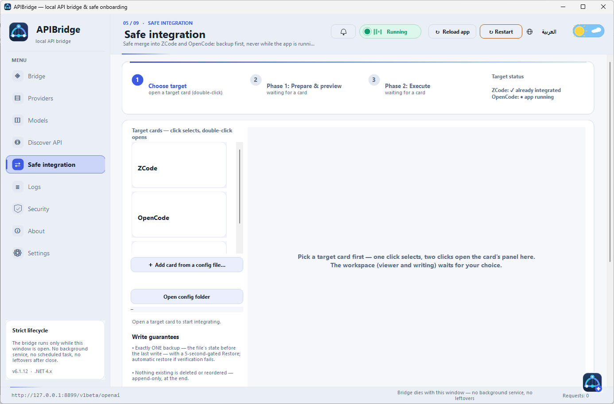
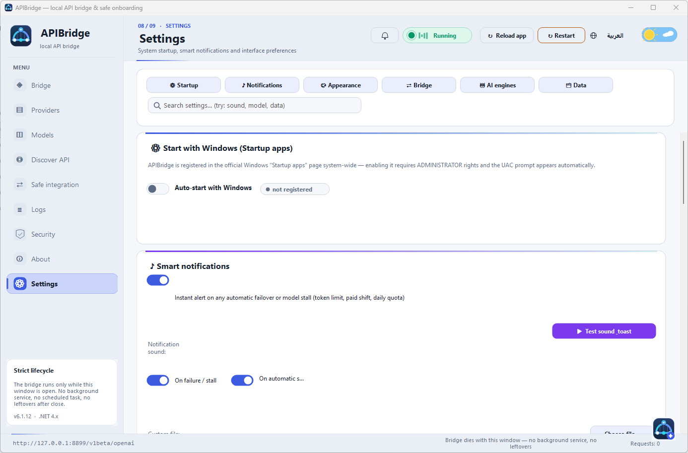
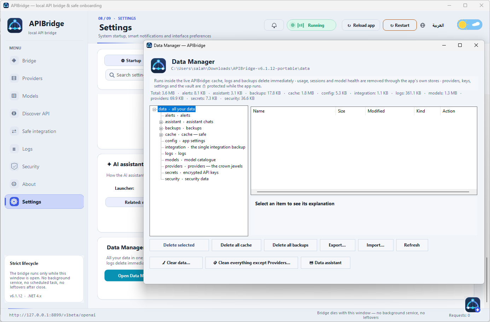

# APIBridge

[](https://github.com/salahamrabdelraouf/APIBridge/releases/latest)
[](LICENSE)
[](https://github.com/salahamrabdelraouf/APIBridge/stargazers)
[](https://github.com/salahamrabdelraouf/APIBridge/releases/latest)
[](PRIVACY.md)

🌐 **Language:** English | [العربية](README.ar.md)

**One local address for all your AI providers — configure your coding tools once, and switch models and providers without ever touching their settings again.**

APIBridge is a local API bridge for Windows. It sits between your coding tools (ZCode, OpenCode, or any OpenAI-compatible client) and your AI providers, exposes a single fixed local endpoint, and routes every request to the right provider and model — with automatic failover when a model or provider fails.

> **Local first, by design.** APIBridge has no cloud, no account, and no telemetry. Your API keys are stored only on your own machine. See [PRIVACY.md](PRIVACY.md) for exactly what APIBridge does and does not do — written precisely, because precision is the trust.

---

## Why APIBridge?

- **One endpoint, forever** — your tools point at one local address, once. Add, remove, or reorder providers inside APIBridge; your tools never notice.
- **Same-model failover** — if a model fails at one provider, the same model is tried at the next provider that serves it, automatically.
- **🧠 Smart unified model** — two models work as a team and return **one** unified answer, with a coordinator you choose and a fallback chain when a model runs out of credit or fails — including mid-stream continuation from the exact point of failure.
- **Automatic quarantine** — models that hit quota or repeated connection failures are set aside automatically and re-tested on an escalating schedule (2 hours, 5 hours, then daily, up to 7 days), then restored on their own when they recover.
- **A Data Manager inside Settings** — see what every file in the data folder stores, delete cache and backups safely, wipe everything except your providers, export/import — with explanations and safety labels for every item.
- **Security built in, not bolted on** — loopback-only listener, Host/Origin guard, optional strict local-token mode, a secret-leak shield for assistant traffic, a skill scanner, and trusted-provider exemptions you approve yourself.
- **A floating AI assistant** — chat with your models from a glass popup, with full Markdown, message edit/retry, and per-model test chat (ping, details, live chat) right from the Models page.
- **Safe integration** — APIBridge writes its record into your tools' config files in their exact original format, with a backup, JSON verification, and a restore that only confirms after a deliberate 5-second wait.

## Screenshots

**Models** — every provider's models in one place, with per-model test chat (ping, details, live chat) one click away:



**Model Test Chat** — try any model at any provider before you rely on it:



**Security** — the shield, trust scores, and exemption controls:



**Safe integration** — write the bridge record into your tool's config, with backup and verification:



**Data Manager, inside Settings** — every file explained and labelled before you touch it:





## What it does / does not do

| ✅ APIBridge does | ❌ APIBridge does not |
|---|---|
| Store your provider keys **locally on your machine**, encrypted at rest (Windows DPAPI) | Send your keys to APIBridge servers — **there are none** |
| Give connected tools a **local token** (in strict mode), never your real provider keys | Collect analytics, telemetry, or usage data of any kind |
| Send each provider **its own key only**, as the normal sign-in for your request | Run in the background after you close it — the bridge lives and dies with the app window |
| Keep logs, usage stats, and history **on your device** | Modify your tools' other providers, keys, or settings during integration |
| Fail over, quarantine, and re-test models **automatically** | Promise that a provider itself does not log your requests — that is the provider's own policy |

The full, precise statement is in [PRIVACY.md](PRIVACY.md) and [SECURITY.md](SECURITY.md).

## Download & verify

Releases are **portable ZIP packages** — no installer, no registry, no AppData. Extract, run `APIBridge.exe`, done. Your data lives in a `data` folder beside the executable, so the whole install is one folder you can move or back up.

Every release publishes `SHA256SUMS.txt` next to the portable archive. Verify your download before running it:

```powershell
certutil -hashfile APIBridge-vX.Y.Z-portable.zip SHA256
```

## Quick start

1. Extract the portable ZIP anywhere.
2. Run `APIBridge.exe` and add a provider (paste a site URL + API key — APIBridge discovers the endpoint and model catalog by itself).
3. Open **Safe integration**, pick your tool (ZCode / OpenCode), and write the bridge record — one time only.
4. Use your tool as usual. The model ID in each request chooses the provider; failover handles the rest.

## Project status

APIBridge is actively developed. The public roadmap and changelog live in [ROADMAP.md](ROADMAP.md) and [CHANGELOG.md](CHANGELOG.md), and the same texts are readable inside the app on the About page.

## Support the project

- ⭐ Star this repository
- 🐛 Report a bug via [Issues](../../issues) (please use the templates)
- 💬 Community: [Telegram](https://t.me/PromptixOfficial) · [Facebook](https://facebook.com/Promptix)
- ❤️ Sponsorship is welcome via GitHub Sponsors (see the Sponsor button above)

## Contributing

See [CONTRIBUTING.md](CONTRIBUTING.md) and our [Code of Conduct](CODE_OF_CONDUCT.md).

## License

[MIT](LICENSE) — see the license file for details.

---

*APIBridge is a local tool. It is not affiliated with ZCode, OpenCode, or any AI provider.*
